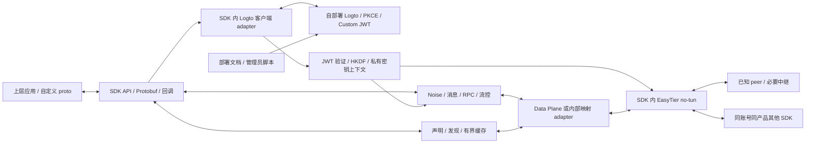

# SDK 技术方案 v0.2

项目名为 CyberBus，多平台范围和接入方式以 [应用接入指南](INTEGRATION.md) 为准；本文件保留网络与派生细节。

本文件定义客户端 SDK 的设计基线；当前实现与验收范围见 [未解决事项](UNRESOLVED.md)。上层契约见 [SDK API](sdk-api.md)，消息格式以 [Protobuf schema](../proto/cyberbus/easytier/v1/sdk.proto) 和 [协议](protocol.md) 为准。除 Logto OAuth/OIDC 自身规定的 HTTPS/JSON/JWT 外，本 SDK 的应用接口数据和终端协议统一使用 Protobuf。

安全约束见 [设备屏蔽与凭证恢复](security.md)：维持仅 Logto + EasyTier，**同账号认证设备默认可信**；手动 block 后停止与该身份的数据、配置、能力和 schema 交换。SDK 定期真实刷新 Logto token 检测凭证变化，确认后停旧网并提示重新登录。当前参考脚本的部署级 epoch 不提供单账号恢复。

## 1. 最终结构与交付边界



一个 SDK 实例属于一个当前账号/产品。`Runtime` 创建 Auth、IdentityStore、Network、Directory、Protocol、Dispatcher；各模块不能绕过 Runtime 的关闭代际。应用声明本机信息/能力并注册 handler；SDK 根据设备 ID 选路，应用不需要知道 IP 或端口。

| 模块 | 责任和边界 |
| --- | --- |
| LogtoAdapter | Logto Native PKCE、托管注册、回调、刷新、退出；官方 SDK 或基础验证阶段选定的成熟 Rust OAuth/OIDC 适配实现，唯一 grant owner |
| CredentialContext | 验证 resource JWT/专用 claim，派生网络与业务密钥；不公开 token/seed |
| CredentialMonitor | 定期真实签发核验、离线租约、变更/撤销分类及重新登录锁存；复用唯一 grant owner |
| DevicePolicyStore | 持久化本地屏蔽表；认证后默认可信，逐次把关数据及信息交换 |
| IdentityStore | 静态 X25519 安装身份、每次运行 boot ID、命名空间内地址偏好 |
| NetworkAdapter | EasyTier 实例、外层相遇、中继、Data Plane 或映射流接口 |
| AddressManager | 静态候选地址、持续冲突检测、重建与容量隔离 |
| Directory | 路由候选 → 认证声明；快照/revision、探测、离线和回调 |
| ProtocolRuntime | Protobuf、Noise、消息/RPC、ACK、取消、分片和有界队列 |
| Dispatcher | 回调串行化、应用 handler 生命周期、线程隔离、背压 |

发布材料分为客户端 SDK（含依赖、生成类型、示例）和 Logto 初始化包（`deploy/` 中的脚本及本目录部署文档）。首轮不改现有生产 SDK；新实验 crate、锁文件及语言绑定后续独立实现。

## 2. Logto 内部完成凭证发行

### 2.1 部署阶段与终端权限

部署者创建 Native 应用、固定 API resource、`network:join` scope 与用户角色，设置回调、托管注册及 User access token Custom JWT。敏感配置放 JWT 脚本环境：根密钥、issuer、resource、允许 client → product 映射、credential epoch 和配置版本。

客户端只申请 `openid network:join`；持续互联/后台凭证检查建议增加 `offline_access`，需要用户显示资料时才增加相应 profile scope。无刷新授权时，必须在 token 到期或 10 分钟验证租约到期的较早时间停网提示交互登录。SDK 无 Management API、M2M、client secret、custom-data 编辑或脚本管理权限。登录与注册均走 Logto 托管流程，Android 可选系统浏览器或 WebView，容器不持有 OAuth grant；SDK 不收用户密码、不创建管理员身份、不用设备之间复制 grant。

Custom JWT 在令牌签发/刷新路径运行；账号种子确定性派生，无需创建用户 seed 行，不依赖 Action 首次登录写入数据。Action 可做额外账号策略，但不是种子发行前置条件；当前 Post sign-in Action 不在注册/刷新时运行，不能当作完整生命周期钩子。具体版本与管理员步骤见 [部署文档](logto-deployment.md)。

### 2.2 专用 JWT 契约

专用资源 access token 带 claim `https://cyberbus.x.aixgg.com/easytier/credentials/v1`，内容如下（OIDC 格式例外仍为 JSON）：

```json
{
  "version": 1,
  "product_id": "部署者配置的产品标识",
  "credential_epoch": "1",
  "account_seed_secret_hex": "32字节种子的小写十六进制",
  "max_devices": 256,
  "virtual_cidr": "10.144.0.0/20",
  "control_port": 11000,
  "config_version": "1"
}
```

hook 输入的 `token.clientId/accountId` 是 Logto 内部签发上下文，不等于最终 JWT 的 `client_id/sub`。参考脚本交叉核对 `context.user.id` 和 `context.application.type=Native`；只对固定 resource、允许 client、`network:join` 用户 token 下发 claim，非目标 API 不附加秘密。脚本顶层额外输出 `client_id` 供终端核验；不覆盖标准 sub/iss/aud/exp。

本版本只支持 **public subject**：部署必须保证最终 resource JWT 的 `sub` 等于 hook 的 `token.accountId`，且同产品各 Native client 对同一账号得到同一个 sub；不启用 pairwise subject 或其他 subject 重写。服务端编码 accountId、客户端编码最终 sub，二者相等是下述算法成立的前提。管理员需在真实首次注册、登录和刷新路径验收该绑定；不能仅比较 seed，因为相同 seed 配不同 sub 仍会派生出不同网络。

SDK 使用固定 issuer/discovery/JWKS、算法允许列表、audience、sub/iat/exp/client_id/scope 核验完整 JWT，然后才读取 seed；要求真实 client 在静态允许集合、产品与预期一致，拒绝 M2M、冲突 azp、未知版本/网段/上限和缺 claim。不提供“只 decode token 就连网”的 fallback。

JWT 是签名而非加密。该 token 特意包含网络凭证，只供 SDK 原生私有层获取；不发送给业务 peer、不交给上层应用/日志/监控和通用 API。SDK 向 peer 证明的是账号 PSK 与安装静态密钥的持有，不转发 JWT。需要不含 seed 的业务 API token 时使用不同 resource，hook 不为其添加此 claim。

JWT 脚本无日志输出不代表 Logto 不记录其结果。已读版本会将完整返回值放入审计上下文；本契约特意让 claim 键含 `credentials`、种子字段含 `secret`，匹配该版本的敏感字段规则，分别屏蔽整个 claim 和叶子值。生产发行前仍必须验证实际服务端的审计脱敏与全部日志出口，具体见 [部署前置](logto-deployment.md#1-目标版本与已有配置)。未通过时不安装生产根密钥、不向真实账号发行 seed；目标版本不具备这些规则时必须先补齐脱敏。

### 2.3 派生规则

`encode(fields...)`：每字段为 4 字节无符号大端字节长度加原始字节；字符串 UTF-8，不做归一化。issuer 使用固定精确值，sub/product 使用经验证原值；epoch 是 u64 范围内无前导零十进制 ASCII，传输也使用字符串，避免 JS 精度损失。嵌套 scope 按原始字节编码。HMAC 和 HKDF 都使用 SHA-256。

```text
scope = encode("cyberbus/seed/v1", issuer, sub, product_id, epoch)
account_seed = HMAC_SHA_256(root_key_raw_bytes, scope)
prk = HKDF-Extract(SHA256(encode("cyberbus/v1", scope)), account_seed)
network_name   = "cg-et-mvp-" + lowercase_hex(HKDF-Expand(prk, "network-name", 16))
network_secret = unpadded_base64url(HKDF-Expand(prk, "network-secret", 32))
app_psk        = HKDF-Expand(prk, "app-handshake-psk", 32)
binding_id     = HKDF-Expand(prk, "session-binding-id/v1", 32)
```

根密钥只在 Logto 管理域。相同账号/产品/epoch 跨设备与刷新得到相同 seed；不同账号/产品不能互推。生产种子不写 custom data，产品配置变更与凭证 epoch 分开。所有实例必须使用一致根密钥与策略，禁止多副本各生成根密钥。

### 2.4 离线和撤销

默认账号 seed/grant 仅在 SDK 私有内存；可选持久授权使用平台安全存储，不能写 Web Storage/普通配置。Logto 暂时离线时可在验证租约内继续使用已有网络材料；默认截止时间为最近成功核验对应的真实签发请求开始后 10 分钟，耗尽即停止远程并提示重新登录。冷启动先真实签发验证再开网，不能靠旧缓存续租。auth degraded 与 network reachable 独立展示，暂时无法验证不等于凭证已变。

SDK 默认每 5 分钟±20%通过唯一 Logto adapter 强制真实刷新，不把读取缓存算作成功。完整核验后比较 epoch 和私有派生材料；变更/明确撤销立即关旧网、推进 generation 并锁存 `REAUTH_REQUIRED`，直到用户交互登录成功，再由应用显式 start。后台恢复和 silent refresh 不清除锁存。具体超时、无刷新能力的降级、UI 原因及重启规则以 [安全方案第 3 节](security.md#3-凭证变更如何发现并提示重新登录) 为准。

共享 PSK 不提供即时单设备云吊销。轮换根密钥/epoch 让正常 SDK 按检测/租约规则退出旧网，恶意旧实例之间仍可能保持旧网。这里的本地验证租约是正常 SDK 的截止策略，无中心设备状态，也不是全局强制的授权租约。

## 3. 应用内传输与可选端口映射

锁定 EasyTier `v2.7.1` / `0d9c52b169dc2112687ddefcf571cd01d383193c` 为首选实验版本（预发布）。网络主约束是不创建系统 TUN、不改系统路由/DNS/代理，不提供任意网络访问能力。两种 adapter 都实现 `listen/connect/cancel/close` 的虚拟字节流契约。

| adapter | 机制 | 用途与限制 |
| --- | --- | --- |
| `NativeDataPlane`（首选） | 原生 `data_plane_tcp_bind/connect`，实例内 smoltcp | 无 OS 业务 listener；Rust SDK 优先 |
| `LoopbackBridge`（可选） | EasyTier 支持的 SOCKS/port_forward 将受限 loopback 流接入虚拟端点 | 仅用于 API/平台不兼容；随机本机端口、可取消、完整回收，不能默认绑定 0.0.0.0 |
| `LocalServiceAdapter`（显式扩展） | 将应用指定的本机服务封装成同一认证/Protobuf 方法 | 只允许逐项声明的 loopback 目标；不把目标主机/端口直接交给远端用户 |

`port_forward.bind_addr` 监听本机 OS socket，`dst_addr` 才是目标，不能写反。接收方向可能还需 no-tun 的入站转接；具体版本必须实际验证。禁止把“TCP 转发已经连通”当作 Protobuf/应用认证已完成。

无论 adapter：虚拟控制服务固定 `11000/TCP`，保留 EasyTier 加密；会话再做标准 Noise PSK 握手，固定候选 `Noise_XXpsk3_25519_ChaChaPoly_SHA256`，实际库支持须验证。prologue 绑定双方版本 hello、由账号/产品/epoch 派生的 binding_id 和配置版本；远端静态 X25519 公钥的 SHA-256 为 32 字节 device_id，显示为 64 字符小写 hex。认证后才能读声明/调用方法，完整记录格式以协议文档为准。

可选 loopback listener 不等于 localhost 已可信：本机其他进程也可连接，入口必须验证本次私有随机 bridge capability 或完整 Noise 身份；内部代理只接受规定目标。默认代理/CIDR/exit node 全部关闭或由实际 ACL 限制，防止未绑定虚拟端口落到系统服务。通过独立攻击节点验证接收端，不能仅靠本 SDK 的发送端白名单。

UPnP/NAT-PMP 路由器自动映射仍默认关闭；普通 STUN、外层 TCP/UDP socket 和必要中继可使用。SDK 内端口映射是实现选项，不要求用户手动配置路由器映射。管理 RPC 优先进程内，必要 OS 管理入口须受限并纳入生命周期。

## 4. 256 台设备的地址与容量

### 4.1 容量定义

每 `(issuer, sub, product)` 最多支持 256 个活跃安装身份，**含本机**；同账号不同产品彼此隔离。本机和最多 255 个已验证远端进入设备快照。历史离线项有 TTL；未认证路由候选不算在线设备，不能通过声明的名字或 IP 增加名额。

这是正常 SDK 的支持上限，不是中心注册配额。稳定连通视图超过 256 时按 device_id 字节序统一选择前 256 个安装身份，其他 SDK 发 `CAPACITY_EXCEEDED`、关闭应用层服务并保持有界的容量重试/身份探测；peer 路由/认证控制流用于形成视图，不等于已接纳业务设备。应用快照和会话硬有界，不能无限载入超额声明。

分区时各分区无法知道全局总数，暂时超额和视图差异不可完全消除；合并后重新排序和准入。持有共享 seed 的非 SDK 实现可绕过 SDK 限制。若“256”需要成为抗恶意、全局强一致的许可证/准入配额，须改为服务端原子设备租约或签名设备席位，增加中心授权状态；这与本方案的无设备表目标是明确取舍。

### 4.2 地址空间

默认 `10.144.0.0/20`，可用地址 `10.144.0.1–10.144.15.254`（跳过整个 /20 的网络与广播地址，共 4094；中间各 /24 的 `.0/.255` 在 /20 中仍可用）。不把 256 台压进只有 254 地址的 `/24`，也不把 4094 地址当成 4094 台支持容量。

地址偏好按 `(namespace, cidr, device_id)` 缓存；无偏好则哈希取模，从 4094 地址环形找候选。必须检测实际重复 route claim；不能因业务无响应判 IP 空闲。使用静态地址 `dhcp=false`；路由表反映其他 peer 的地址声明，不作为业务在线证明。

### 4.3 冲突收敛

tentative 加入 → 收集路由 → 相同 IP 按 peer_id 规范数值排序、最小者保留 → 其余关闭 gate、取消旧流、随机退避并换候选 → 重建/重新认证。初值每秒最多一个重建、退避上限 5 秒，每次加入最多 64 候选，耗尽返回 `CONFLICT`（脱敏说明地址冲突）并后台有界重试，不把重试预算用尽误报“4094 地址全满”。

控制服务在 tentative 阶段可做身份/容量/冲突握手，业务 handler 关闭；稳定后才发设备可达。冲突、网络恢复、分区合并时重核；两秒轮询或上游变更事件只更新路由视图，不主动握手全部节点。重复 peer_id/IP 的完整可观察性必须实测，若 API 丢失重复声明，则当前机制不能宣称可用。

安装身份是静态公钥 SHA-256，boot ID 每次运行随机。旧缓存/路由/迟到响应不能判身份复制；只有当前 generation、同一 10 秒窗口内两个不同 boot ID 各自通过新鲜认证存活挑战才报复制并隔离，正常重启只替换过期记录。

## 5. 面向规模的发现与回调

### 5.1 发现来源

1. 订阅/轮询本地 EasyTier 全网路由摘要，生成合法池内 IP 候选，合并已验证缓存；不能只用“直连邻居列表”，必须覆盖经中继/间接路由的设备。
2. 新/变更候选通过控制流完成 Noise、Hello、声明摘要/按需 descriptor 获取。缓存按 device_id 主键，而非 IP；同一 IP 换身份不得接管旧会话。
3. 已认证会话收到声明 revision 变化和轻量 liveness 更新，转换为上层 callback。没有业务会话的设备以 60–120 秒抖动抽样复核，不为全部 255 对端保留应用长连接。
4. 用户 refresh、路由信息缺失或恢复场景可触发有界网段补扫，使用游标公平轮换。正常运行不每 45 秒全扫 /20。

| 初始预算 | 默认值（待实测） |
| --- | --- |
| 路由摘要读取 | 变更事件优先，轮询兜底 2 秒 |
| 认证探测并发 | 每实例 16；接收端握手最多 32 |
| 应用持久 peer 会话 | 每实例最多 16，闲置 LRU 回收；与底层 EasyTier 连接数独立 |
| 新候选 connect / 认证 | 1 秒 / 2 秒；必要首次建路可用 3 秒 |
| 单轮候选探测 | 总预算 30 秒；超时为 partial，不下线未探测项 |
| 补扫 | 最多 256 地址或 20 秒，扫描并发 16，正常最多每 5 分钟一轮 |
| 在线会话 liveness | 30 秒±20% 抖动，业务流量可刷新 liveness |
| 离线判定 | 距最后认证活动至少 180 秒，且跨两轮至少 3 次实际失败；本地网络未知时不全员标 offline |
| descriptor 缓存 | 按 descriptor hash 拉取，有界 LRU；不会随心跳重复发送 |

007 当前实现对业务按需获取使用 `min(获取开始+10秒, 原命令提交时间+timeout)`，
TCP 子阶段最多3秒，Noise/Up/owner共用剩余期限；入站握手10秒，出站后台probe
保持2秒。可选匿名中继与触发范围见 [Cloudflare兜底](CLOUDFLARE_FALLBACK.md)。

256 设备初次两两发现最多出现 `256×255=65,280` 次有向探测；需启动抖动、候选去重、连接复用和入站限流。应用会话上限**不会**自动限制 EasyTier 自身的 P2P/路由连接，256 节点的底层拓扑、FD/RSS、打洞和中继负载必须独立验收。不能预先宣称只需 O(N) 连接。

### 5.2 状态和版本

本地目录有单调 revision 和 account generation；watch 注册先投递一致快照，再按序投递 added/updated/offline/removed/reset。注册快照与接收增量之间由同一 dispatcher 保证无丢失窗口；溢出发 reset+新快照，不悄悄丢设备事件。

目录内部区分 reachable/suspect/offline/conflict；公开 `DevicePresence` 使用 ONLINE/OFFLINE，suspect 暂不改变公开 presence，conflict 先阻断业务并通过网络/操作错误报告，不能冒充新的可用设备。overlay 连通、应用认证、调用成功三者分开。IP 变化或 capabilities/public config 更新生成 updated；removed 表示 TTL/显式退网后的本地目录移除，不代表云端删设备。退出立即清理当前 generation；所有迟到回调丢弃。

公开名称、配置和能力由应用声明，经 SDK 检查类型、大小和 revision 后在认证会话内分发；只有元数据摘要改变才获取完整声明。私有配置、系统路径、OAuth/网络秘密不从“获取客户端配置”隐式导出。上层声明的行为授权由注册 handler 和本地访问策略共同决定。

## 6. 消息、能力和应用接口

所有本地 SDK 命令/结果/事件、设备元数据和终端报文定义为 Protobuf；应用扩展消息用注册 type URL 的 `Any`，schema descriptor 按需读取。应用可以声明自定义接口和实现 handler，也可以只使用 `send/receive` 消息。调用者选择 `device_id + method_id` 或消息类型，不指定目标主机端口。

协议必须定义消息接收/入队/业务完成不同 ACK、request/message ID、超时/取消、重放窗口、断线结果未知、分片重组、按 stream 信用流控与上限。不得把“发送 API 返回成功”当成对方完成处理；默认不重放非幂等业务，不承诺 exactly-once。详细边界集中在 [protocol.md](protocol.md)，不在各模块重复发明格式。

## 7. 生命周期

```text
Created -> AuthPending(login/sign_up) -> Authenticated / RemoteDisabled
RemoteDisabled --start_network--> Joining -> Tentative -> Discovering -> Ready
Ready --网络变化--> Reconnecting -> Tentative/Discovering
任意远程态 --凭证变更/授权撤销/验证租约耗尽--> ReauthRequired / RemoteDisabled
ReauthRequired --用户交互登录并核验成功--> Authenticated / RemoteDisabled
任意远程态 --stop_network/logout/close--> Closing -> RemoteDisabled/SignedOut/Closed
```

`close/stop_network/logout` 先关本地 admission gate、推进 generation，再停止 discovery、取消消息/RPC/handler、关闭 adapter/映射与 core。OAuth grant 清理/云端撤销独立返回真实结果，不因云端失败反向开启网络。上层回调不能持有 Runtime 锁，handler 可取消、可超时；一个慢 handler 不阻塞其他设备目录和关闭流程。

稳定错误覆盖认证配置/claims 缺失、容量超限、地址冲突、无路由、设备不可达、协议/类型不匹配、方法未暴露、消息过大、队列满、取消、关闭及结果未知；具体枚举由 schema/协议维护。自动恢复沿同一有效账号上下文，账号切换不能继承上个账号的消息队列、缓存或桥接 capability。
